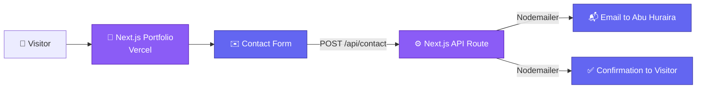

<div align="center">

<a href="https://huraira-labs.vercel.app/">
  
</a>

<br/>

[](https://huraira-labs.vercel.app/)
[](https://huraira-labs.vercel.app/)
[](https://huraira-labs.vercel.app/resume.pdf)


<br/>

<a href="https://huraira-labs.vercel.app/"><b>🌐 Live Site</b></a>
&nbsp;•&nbsp;
<a href="#-features"><b>✨ Features</b></a>
&nbsp;•&nbsp;
<a href="#-getting-started"><b>🚀 Get Started</b></a>
&nbsp;•&nbsp;
<a href="#️-deployment"><b>☁️ Deploy</b></a>

</div>


## 📑 Table of Contents

- [🌟 About](#-about)
- [📸 Screenshots](#-screenshots)
- [🧭 Portfolio Sections](#-portfolio-sections)
- [✨ Features](#-features)
- [🚀 Projects Showcased](#-projects-showcased)
- [🛠️ Tech Stack](#️-tech-stack)
- [🏗️ Architecture](#️-architecture)
- [📂 Project Structure](#-project-structure)
- [🚀 Getting Started](#-getting-started)
- [🔐 Environment Variables](#-environment-variables)
- [☁️ Deployment](#️-deployment)
- [👨‍💻 Author](#-author)


## 🌟 About

This is the personal portfolio of **Abu Huraira**, a Full Stack Developer and BS AI student at Minhaj University Lahore. It showcases my skills, learning roadmap, projects, and education in a sleek, futuristic dark interface with smooth animations.

> 🌐 **Live site:** [https://huraira-labs.vercel.app](https://huraira-labs.vercel.app/)

My interests lie at the intersection of **artificial intelligence, blockchain technology, and autonomous agents**, and I am currently deepening my **Django backend** skills.

<div align="center">



</div>

---


## 🧭 Portfolio Sections

| Section | What you'll find |
|---|---|
| 👤 **About** | Who I am, what I study, and what I'm interested in |
| ⚙️ **Skills** | The technologies and tools I work with |
| 🗺️ **Roadmap** | My learning path and goals |
| 💼 **Projects** | Featured projects with descriptions |
| 🎓 **Education** | My academic background |
| ✉️ **Contact** | A working contact form that delivers email straight to my inbox |

---


## ✨ Features

| | Feature | Description |
|:---:|---|---|
| ⌨️ | **Animated hero** | A typing-effect headline with a glowing, futuristic dark theme. |
| 🎞️ | **Smooth animations** | Built with Framer Motion for fluid transitions and micro-interactions. |
| 🧭 | **Smart navigation** | A top navigation bar with active-section highlighting and a floating bottom dock. |
| 💼 | **Featured project cards** | Clean cards with images and detailed descriptions. |
| 📄 | **Downloadable resume** | One click to view my latest resume PDF. |
| ✉️ | **Working contact form** | Sends an email to me and an automatic confirmation to the visitor. |
| ⬆️ | **Scroll-to-top button** | Quick navigation back to the top of the page. |
| 📱 | **Fully responsive** | Looks great on phones, tablets, and desktops. |
| ⚡ | **Fast deployment** | A single Next.js project deployed on Vercel. |

---


## 🚀 Projects Showcased

| Project | Highlights |
|---|---|
| 🤖 **AI Agent Framework** | An autonomous AI agent system built with Python and LLM APIs that breaks down complex tasks, makes decisions, and executes actions independently. |
| ⛓️ **Blockchain Smart Contract** | Smart contracts for Ethereum with ERC-20 token standards, automated market makers, and governance mechanisms, built with security and gas efficiency in mind. |
| 🌐 **Django REST API Backend** | A scalable REST API with Django and PostgreSQL, featuring JWT authentication, role-based access control, API documentation, Docker, and CI/CD. |

---


## 🛠️ Tech Stack

<div align="center">


</div>

| Layer | Technologies |
|:---:|---|
| 🎨 **Frontend** | Next.js 15, React 19, TypeScript, Tailwind CSS 4 |
| 🎞️ **Animation** | Framer Motion |
| ✉️ **Contact Form** | Next.js API route + Nodemailer |
| ☁️ **Hosting** | Vercel |

---


## 🏗️ Architecture

The portfolio is a **frontend-only** project: one Next.js app that deploys directly to Vercel. The old Python/Django backend has been removed, and the contact form now runs through a built-in Next.js API route.



The contact form sends two emails:
1. **To me:** `New Contact Form Submission: <name>` with the visitor's name, email, and message. Replying goes straight to the visitor.
2. **To the visitor:** a `Thank you for contacting us!` confirmation.

---


## 📂 Project Structure

```text
YOUR-REPO-NAME/
├── app/
│   └── api/
│       └── contact/
│           └── route.ts      # Contact form API (Nodemailer)
├── components/
│   └── contact.tsx           # Contact form component
├── lib/
│   └── dummy-data.ts         # Projects & skills content
├── public/
│   └── resume.pdf            # Downloadable resume
├── assets/                   # Animated README graphics (SVG)
├── docs/
│   └── screenshots/          # README images
├── .env.example              # Environment variable template
├── package.json
└── README.md
```

> Other components and pages live alongside these folders.

---


## 🚀 Getting Started

Want a quick look? 👉 **[Open the live portfolio](https://huraira-labs.vercel.app/)**. To run it locally:

### Prerequisites

- **Node.js** 18+
- **npm**
- **Git**

### 1️⃣ Clone the repository

```bash
git clone https://github.com/abuhuraira5130/YOUR-REPO-NAME.git
cd YOUR-REPO-NAME
```

### 2️⃣ Install dependencies

```bash
npm install
```

### 3️⃣ Set up environment variables

```bash
cp .env.example .env.local      # Mac / Linux
copy .env.example .env.local    # Windows
```

Then fill in the blank fields (see below).

### 4️⃣ Start the development server

```bash
npm run dev
```

Open [http://localhost:3000](http://localhost:3000).

---


## 🔐 Environment Variables

Set these in `.env.local` (local) **and** in Vercel (production):

| Variable | Required | Description |
|---|:---:|---|
| `EMAIL_HOST_USER` | ✅ | Your Gmail address |
| `EMAIL_HOST_PASSWORD` | ✅ | A Gmail **App Password** (not your normal password) |
| `CONTACT_RECIPIENT_EMAIL` | ➖ | Where form submissions are delivered. Defaults to `EMAIL_HOST_USER`. |
| `DEFAULT_FROM_EMAIL` | ➖ | Sender address. Defaults to `EMAIL_HOST_USER`. |

<details>
<summary><b>🔑 How to create a Gmail App Password</b></summary>

1. Open your Google Account → **Security**.
2. Turn on **2-Step Verification**.
3. Go to **App passwords** and create one for "Mail".
4. Use the 16-character code as `EMAIL_HOST_PASSWORD`.

</details>

> ⚠️ **Never commit `.env.local` or your App Password to GitHub.**

---


## ☁️ Deployment

1. Push this project to GitHub.
2. Import it into [Vercel](https://vercel.com): Framework Preset **Next.js**, Root Directory `./`.
3. In **Project → Settings → Environment Variables**, add the variables from `.env.example` with your real values.
4. Click **Deploy**. The default build command is `npm run build`.

🌐 **Production URL:** [https://huraira-labs.vercel.app](https://huraira-labs.vercel.app/)

---


## 👨‍💻 Author

<div align="center">

### **Abu Huraira**
*Full Stack Developer · BS AI Student*

[](https://github.com/abuhuraira5130)
[](https://huraira-labs.vercel.app/)

<br/>

⭐ **If you like this portfolio, give it a star!** ⭐


</div>
